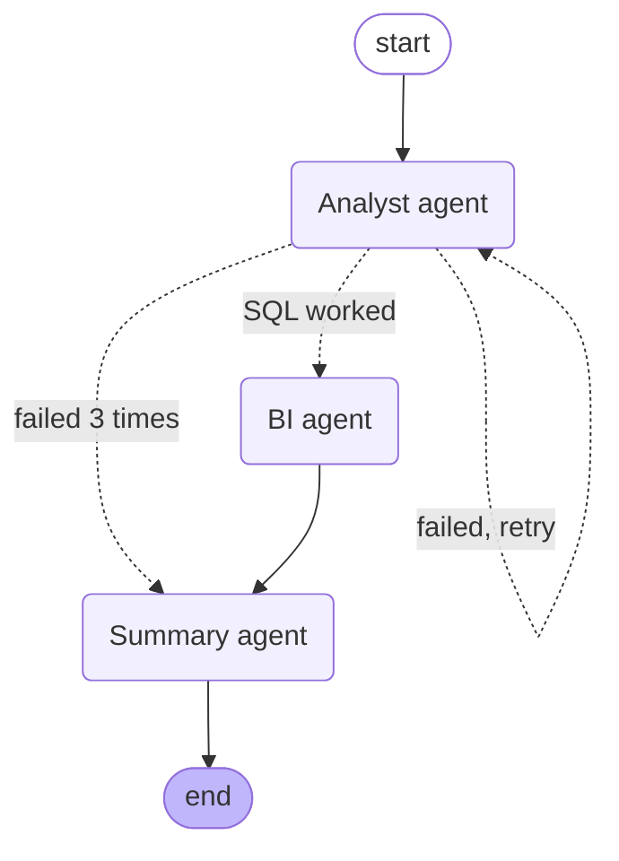
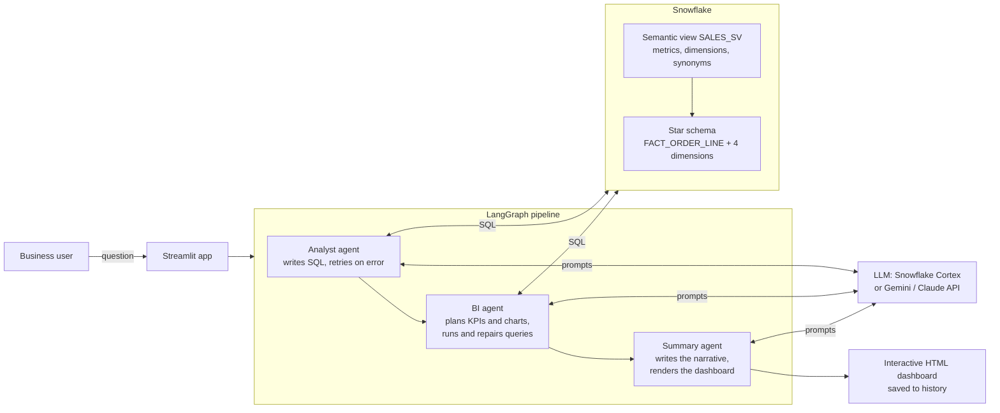

# LangGraph Multi-Agent Analytics on Snowflake

**Analyst agent + BI agent + Summary agent: ask a business question in plain English, get back a full dashboard.**

Three AI agents work in a LangGraph pipeline on top of a governed Snowflake semantic layer:

- **Analyst agent** writes and runs the SQL
- **BI agent** designs the dashboard and runs its own supporting queries
- **Summary agent** writes the story

The result is an interactive dashboard with KPI cards, charts, a narrative and the SQL behind every number.


**Live demo:** https://riishabhz-langgraph-snowflake-bi-agents-app-xim4cx.streamlit.app/


## Agent graph (generated from the code)


---

## Why I built this

Business users wait days for an analyst to answer "how did revenue in Europe compare with last year?". Text-to-SQL tools answer faster, but they guess at table joins and invent their own definition of "revenue". So two people asking the same question can get two different numbers.

This project fixes that in two ways:

1. **A governed semantic layer.** Metrics such as net revenue, average order value and late delivery rate are defined once, in a Snowflake semantic view. The agents query those definitions instead of writing their own formulas.
2. **Agents that check their own work.** Failed queries are retried or repaired, every tile shows the SQL that produced it, and the summary may only use numbers that came back from Snowflake.

---

## Architecture



### The three agents

| Agent | What it does | Safeguards |
|---|---|---|
| **Analyst** | Reads the semantic view's metric definitions and the documented star schema, writes one read-only query (`SEMANTIC_VIEW()` first, plain SQL as fallback) and runs it on Snowflake | Up to 3 attempts, each fed the previous Snowflake error; SQL guard allows only a single `SELECT` / `WITH`; results capped at 1,000 rows |
| **BI** | Designs a one-page dashboard: 3-4 KPIs with prior-period comparison and 3-5 charts (trend, breakdown, top N, heatmap). Writes and runs a query for every tile | One repair pass for failed tile queries; JSON repair and one retry if the plan comes back malformed; failed tiles are skipped and reported, not hidden |
| **Summary** | Writes the narrative (answer, findings, next steps) from the tile data and renders the dashboard | May only use numbers present in the tiles; told not to over-read tiny differences |

### Semantic layer

Built in `semantic_layer.sql` from the TPC-H sample data that ships with every Snowflake account:

- **Kimball star schema** in `AGENT_DB.ANALYTICS`: `FACT_ORDER_LINE` (6M rows, grain = one order line) plus `DIM_CUSTOMER`, `DIM_PRODUCT`, `DIM_SUPPLIER` and `DIM_DATE`. Keys are declared, every column has a business description, and data quality checks cover uniqueness, orphan keys, nulls and row-count reconciliation.
- **Snowflake semantic view `SALES_SV`** on top: relationships, dimensions, synonyms ("revenue", "sales" and "turnover" all mean net revenue) and 14 governed metrics, including net revenue, average order value, order count, active customers, late delivery rate, return rate and average days to ship.

The agents read the column descriptions and the metric definitions at runtime, so the data dictionary doubles as their context.

---

## Features

- **Natural language to dashboard** in about 30-60 seconds
- **Interactive Plotly charts** with data labels, hover tooltips, a colour-blind-safe palette and one axis per chart
- **KPI cards** with % change against the prior period, coloured by whether the change is good or bad
- **Agent filter**: show only the Analyst's, BI agent's or Summary agent's work
- **Show reasoning**: each agent's SQL, the BI plan, repaired queries and errors, live while it works
- **History**: every run is saved and reopens instantly without re-running the agents
- **Three LLM options**: Snowflake Cortex (data stays in Snowflake), Gemini or Claude, switched with one setting
- **Deploy-ready**: password gate, per-visitor question limit, read-only service user and a warehouse with a credit cap

---

## Data governance

For real client data, set `LLM_PROVIDER=cortex`. The model then runs inside Snowflake through `AI_COMPLETE`, so prompts, data and answers stay within the Snowflake account. The Gemini and Claude options send data to an external API and are meant for public sample data only.

Other controls:
- The app logs in as a **read-only service user** (`AGENT_READER` role) with key-pair authentication.
- Every generated query passes a **SQL guard** before it runs: no DDL or DML, a single statement, row-capped.
- A **resource monitor** suspends the app's warehouse at a monthly credit limit.
- Personal data should be left out of the semantic view or masked.

---

## Tech stack

| Layer | Tools |
|---|---|
| Orchestration | LangGraph (state graph with a conditional retry loop), LangChain core |
| Data | Snowflake, Snowpark, star schema, semantic view, key-pair auth |
| LLM | Snowflake Cortex `AI_COMPLETE`, Google Gemini, Anthropic Claude |
| Visualisation | Plotly, custom HTML/CSS dashboard |
| App | Streamlit (history, live reasoning, password gate) |

---

## Project structure

```
.
|-- app.py                   Streamlit app (UI, history, live reasoning)
|-- agents.py                LangGraph pipeline: Analyst, BI and Summary agents
|-- dashboard.py             Plotly charts and the HTML dashboard
|-- run.py                   Command-line version (opens the dashboard in a browser)
|-- setup.sql                Warehouse and database setup
|-- semantic_layer.sql       Star schema, data quality checks, semantic view
|-- build_semantic_layer.py  Runs semantic_layer.sql from Python (optional)
|-- deploy_setup.sql         Read-only role, service user, credit cap for the public app
|-- gen_keys.py              Generates key pairs for Snowflake login
|-- DEPLOY.md                Streamlit Community Cloud deployment guide
|-- .env.example             Configuration template
`-- .streamlit/config.toml   App theme
```

---

## Quick start

**Prerequisites:** a Snowflake account (the free trial works) and Python 3.12.

1. **Snowflake.** In Snowsight, run `setup.sql`, then `semantic_layer.sql` (select all, then Run). Check that the data quality results are all 0.
2. **Python environment**
   ```bash
   python -m venv .venv
   .venv\Scripts\activate          # Windows (macOS/Linux: source .venv/bin/activate)
   pip install -r requirements.txt
   ```
3. **Login key.** Run `python gen_keys.py`, then run the `ALTER USER` line it prints in Snowsight.
4. **Configuration.** Copy `.env.example` to `.env` and fill in your account details. On a trial account use `LLM_PROVIDER=google` with a Gemini key (Cortex AI functions are not available on trials). On a paid account use `LLM_PROVIDER=cortex`.
5. **Run it**
   ```bash
   streamlit run app.py
   ```
   Or from the command line:
   ```bash
   python run.py "Compare 1997 vs 1996 net revenue by customer region"
   ```

To deploy a public demo, see [DEPLOY.md](DEPLOY.md).

---

## Example questions

- Who are the top 10 customers by net revenue in 1997, and which segment and nation are they from?
- Compare 1997 vs 1996 net revenue by customer region with growth %
- How has the order status mix changed by year from 1992 to 1998?
- Which ship mode has the highest late delivery rate, and how has it changed over time?
- Top 10 brands by net revenue in 1997

---

## Design decisions

- **Semantic view first, SQL second.** Querying governed metrics keeps numbers consistent between questions. Plain SQL on the star schema is the fallback for things the view cannot express, such as rankings within groups.
- **A fixed graph rather than a free-roaming agent.** Analyst, then BI, then Summary, with one conditional retry loop. That is predictable, cheap and easy to debug, and each step can be inspected in the reasoning view.
- **The LLM plans and the code draws.** The BI agent returns a JSON plan; Python runs the queries and builds the charts. The model never makes up numbers or chart data.
- **Failures are visible.** Repaired and skipped tiles are labelled, and the full reasoning is one click away.

## Limitations

- TPC-H is synthetic and evenly distributed, so some breakdowns look flat. The pipeline is built for real business data.
- Chart and KPI choices can differ between runs of the same question (the numbers do not).
- No automated evaluation suite yet (see the roadmap).

## Roadmap

- [ ] Evaluation set: 20+ questions with known answers, scored on every change
- [ ] Per-client configuration (example questions, semantic view, branding)
- [ ] Streamlit in Snowflake deployment with Cortex for client data
- [ ] Query and cost logging per question

---

Built by [Rishabh](https://github.com/riishabhz).
